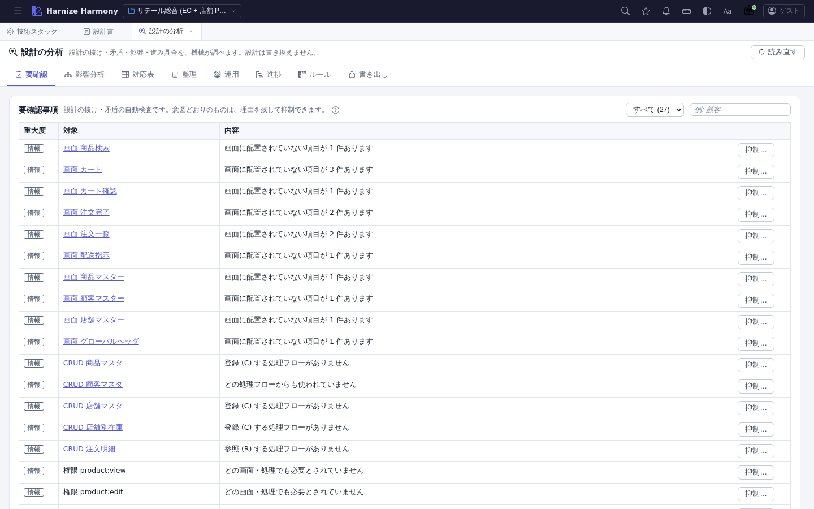

# 設計の分析

> **対象画面**: `DesignAnalysisView` (`frontend/src/components/analysis/DesignAnalysisView.tsx`)
> **ルート**: `/w/:wsId/analysis`
> **仕様**: [design-analysis.md](../../spec/design-analysis.md) / [design-check.md](../../spec/design-check.md)

## 概要

設計の抜け・矛盾・影響・進み具合を、機械が調べる画面。設計は書き換えない (点検の設定 `design-check.json` だけ書く)。

## 画面構成

| タブ | 用途 |
|---|---|
| 要確認 | 設計の要確認事項の一覧。理由つきで抑制できる (期限つき) |
| 影響分析 | 改名・削除・型変更の影響を、画面→処理→テーブルへ推移的にたどる |
| 対応表 | 画面・処理・テーブルの対応 (トレーサビリティ・CRUD ほか) |
| 整理 | 未使用の定義・用語の揺れ・メッセージ |
| 運用 | SLA・ジョブ・外部システムの契約 |
| 進捗 | 成熟度 (下書き / 暫定 / 確定) の集計と推移 |
| ルール | 命名規約・独自の検査ルール |
| 書き出し | テスト雛形・テストデータ・OpenAPI・**図 (Mermaid / PlantUML / SVG)** |

## 書き出し → 図

ER 図・画面遷移図・処理フロー図・業務フロー図を、Mermaid / PlantUML で書き出す (処理フロー・業務フローは SVG も)。コピーするか、ファイルに保存する。他のドキュメント (Markdown・Wiki) にそのまま貼れる。

## 関連仕様書

- [design-analysis.md](../../spec/design-analysis.md)
- [integration-ops.md](../../spec/integration-ops.md) (図の書き出し)
