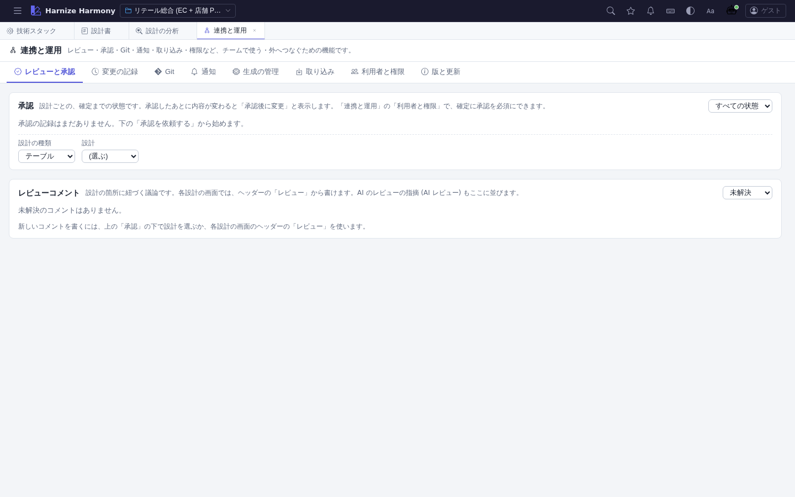

# 連携と運用

> **対象画面**: `OperationsView` (`frontend/src/components/operations/OperationsView.tsx`)
> **ルート**: `/w/:wsId/operations`
> **仕様**: [integration-ops.md](../../spec/integration-ops.md)

## 概要

外へつなぐ・配る・チームで使う機能を 1 か所にまとめた画面。上のタブで切り替える。設計の原本は、「取り込み」(新規作成だけ) と各設定の保存以外では書き換えない。

## 画面構成

| タブ | 用途 |
|---|---|
| レビューと承認 | 設計ごとの承認の状態 (下書き → 承認待ち → 承認済み / 差し戻し) と操作、レビューコメントのスレッド一覧 |
| 変更の記録 | 誰が・いつ・何を変えたか (画面と AI の書き込み)。利用者・語・期間で絞る。CSV で保存 |
| Git | 変更したファイルの確認・差分・選んだファイルのコミット・ブランチの作成と切り替え・履歴 (push / pull はしない) |
| 通知 | Slack / Teams / 汎用の Webhook へ、承認・コメント・要確認の増加・コミットを知らせる (URL は画面に出さない) |
| 生成の管理 | AI が記録した「どの設計から、どのファイルを作ったか」と、いまの設計・ファイルとの突き合わせ。再生成の差分 |
| 取り込み | DDL (CREATE TABLE) → テーブル、OpenAPI (JSON) → 処理フローの骨組み。予行を見て、選んだものだけ新規に作る |
| 利用者と権限 | 閲覧 / 編集 / 承認 / 管理の役割と、「確定には承認を必須にする」の方針 |
| 版と更新 | 版・コミット・リリースノート・更新の確認。配布 image で動いているときは、image を作った commit・ブランチ・日時が出る (main 以外のブランチや、コミットしていない変更つきで作った image は ⚠)。「更新を確認する」は、配布 image では GitHub の main と比べて何 commit 古いかを出す (結果は 1 分ほど覚える)。生成した開発コンテナの雛形が新しくなっていれば、その案内も出る (取り込みは AI に頼む)。実画面での確認: 2026-10-31、tax-app の dev コンテナで、commit 67f373c の image では配布 image の表示とブランチの ⚠ を、main (47d9b36) の image では ⚠ が出ないことと、雛形の「新しくなっています」の案内の表示を確かめた |

## 主要操作

| 操作 | 手段 | 結果 |
|---|---|---|
| 承認を依頼する | 「レビューと承認」の下の「設計の種類」「設計」を選び、「承認を依頼」 | 状態が「承認待ち」になる。承認・差し戻しは、承認の役割以上 |
| 差し戻す | 「差し戻す」→ 理由を書く | 理由は必須。履歴に残る |
| コミットする | 「Git」でファイルを選び、メッセージを書いて「コミット」 | 選んだファイルだけがコミットされる |
| 通知を試す | 「テスト送信…」→「送る」 | 実際に外へ送る (管理者のみ) |
| DDL を取り込む | 「取り込み」に SQL を貼る / ファイルを選ぶ → 予行 → 「取り込む」 | 同じ id・物理名があるものは作らない。取り込んだテーブルは「下書き」 |
| 役割を設定する | 「利用者と権限」で利用者を追加 → 保存 | 最初の設定では、あなたを「管理」にする |

## 各設計の画面から

ヘッダーの **レビュー** (吹き出しの印。未解決のコメントの数つき) から、いま開いている設計の承認の状態・コメントを、その場で見て書ける。コマンドパレット (`Ctrl+K` → `>`) の「この設計のレビューを開く」でも開く。

## データ前提・注意

- 利用者名は、画面右上で設定する自己申告で、本人確認ではない。役割は、誤操作・誤った承認を防ぐ運用上の区別。
- 記録の置き場所: チームで共有するもの (承認・コメント・権限・体裁・生成の記録) は、データフォルダの JSON (git に載る)。通知先 (URL)・変更の記録は、ワークスペースの `.harmony-ops/` (git に載らない)。
- AI (MCP) からは、通知先の登録・変更、承認、権限の変更はできない。AI が書けるのは、生成の記録と、レビューの指摘だけ (指摘は、登録済みの「コメント」の通知先へ、件数だけの 1 通が届く)。

## 関連仕様書

- [integration-ops.md](../../spec/integration-ops.md)
- [server-security.md](../../spec/server-security.md)
