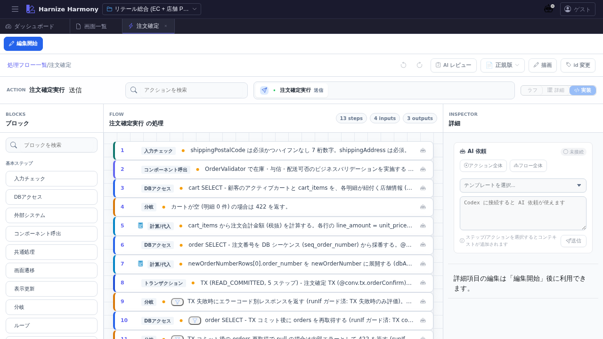

# 処理フロー編集

> **対象画面**: `ProcessFlowEditor` (`frontend/src/components/process-flow/ProcessFlowEditor.tsx`)
> **ルート**: `/w/:wsId/process-flow/edit/:processFlowId`
> **種別**: マルチインスタンスタブ (リソース ID 毎)

> **実画面で確認した日**: 2026-10-17 (「流れ」の表示は 2026-10-19・直す窓口は 2026-10-19: ガードの追加・条件の選び・判定表は目で、動かす・消す・元に戻す・見出し・入力チェックのルール・判定表の保存は、実際の操作 (E2E) で確かめた。確かめていない: SQL・承認者・外部システムの窓の見た目 (単体試験のみ)・ほかのひな型の見た目・ドラッグ・タッチ端末) — **確認した範囲**: 工程の足し方 (アクション → ブロック)・DBアクセス / 画面遷移の入力・保存・「主要エリア」の見え方。**確認していない範囲**: 下の「キーボード」「入れ子」「アウトライン」の行、「データ前提」。以前の記述の「Step 内の + で Action を追加」は誤りだった (アクションが工程の入れ物)

## 概要

Harmony の **一次成果物** である処理フロー (ProcessFlow JSON) を、Step / SubStep / Action / Trigger を組み合わせて編集する画面。本プロジェクトは「AI 読み取りが主、JSON Schema が一次」(`feedback_schema_first.md`) の方針で、UI は JSON 表現を可視化・編集する役割。`/create-flow` / `/review-flow` skill とセットで使う。

## 到達経路

- 処理フロー一覧 (`/process-flow/list`) → 行 / カードを**ダブルクリック**。「作成」した直後は、そのまま編集中で開く
- ダッシュボード「処理フロー成熟度」パネル → 個別の flow をクリック
- 直接 URL: `/w/<wsId>/process-flow/edit/<flowId>`

## 画面構成

> スクリーンショット (上) は、整理前の画面。最新の見え方は、本ページの「主要エリア」の説明のとおり。`/document-ui process-flow-editor` で撮り直せる。

### 主要エリア

1. **編集の帯** (上端) — 「編集中」「保存」「変更点」「破棄」、保存の状態 (「原本と同じ」「原本に未反映 / 下書きは HH:MM にサーバへ保存済み」)。一覧から作った直後は、すでに編集中。一覧から開いた直後は「閲覧中」で、「編集開始」を押すと編集できる
2. **ヘッダー** — 「処理フロー一覧 / 名前」、取り消し・やり直し・履歴、**AI 生成** (閲覧中でないときだけ出る)・**AI レビュー** (常に出る。使うには AI の接続が要る)、編集中の状態の切り替え、**描画** (マーカーの手描き)、**図で見る**、**参照元**、**ID 変更** (閲覧中・未保存の変更があるあいだは押せない)、リセット
3. **アクションのバー** — 処理フローは「**アクション**」の集まり。アクションは、画面のボタンなどの**きっかけ (トリガー: クリック / 送信 / 選択 / 変更 / 読込 / タイマー / other)** ごとに 1 つ作り、その中に工程を並べる。右端の「＋」(`アクション追加`) で足す。検索欄でアクションを探せる
4. **表示の深さ** (アクションのバーの下) — **ラフ** (概要だけ) / **詳細** / **実装** (SQL・式・エラーまで)。**一覧から新しく作ったフローは「詳細」で始まる** (「ラフ」は、テーブル・操作・遷移先を選ぶ欄まで隠れる。「詳細」と「実装」の差は、小さい: 「詳細メタ情報」(Saga・外部 chain・SLA) の欄が、「実装」だけに出る)。すでにあるフローは「実装」が初期値 (深さは、フローごとに、このブラウザに覚える)。流れを書いてから、深くするとよい
5. **左「ブロック」** — 工程の種類のパレット。基本ステップ: 入力チェック / DBアクセス / 外部システム / コンポーネント呼出 / 共通処理 / 画面遷移 / 表示更新 / 分岐 / ループ / ループ終了 / 次の繰り返し / ジャンプ / 計算/代入 / レスポンス返却 / ログ / 監査 / ワークフロー / トランザクション / イベント発行・購読 / 締め処理 / CDC / AI 呼出 / AI エージェント。「目次」タブで工程の一覧。検索欄あり
6. **中央「FLOW」** — 工程のカードが縦に並ぶ。表示は「カード / **流れ** / アウトライン / 図 / 表」の切り替え (「流れ」は、読むための表示: 下の「流れで読む」)。右上に「N steps / N inputs / N outputs」
7. **右の欄** (見出しは「詳細」、小さな見出しは「INSPECTOR」) — AI への依頼 (テンプレート・自由な文)、基本情報、AI へのマーカー、エラーカタログ、Ambient 変数、Secrets、環境変数、外部システム、レスポンス型、成熟度。アクションを選んでいると、HTTP 契約・SLA / Timeout も出る (どちらも編集中だけ。閲覧中は「詳細項目の編集は「編集開始」後に利用できます。」)
8. **ダイアログ類** — アクション追加 (アクション名・トリガー)、画面項目の選択 (式で参照するとき)

## 主要操作

| 操作 | 手段 | 結果 |
|---|---|---|
| アクションを足す | 上のバー右端の「＋」→ **アクション名** (例: 登録ボタン)・**トリガー** (既定: クリック) → 「追加」 | アクションができる。**アクションが 1 つも無いと、工程は足せない** (中央に「上部の + ボタンからアクションを追加してください」と出る) |
| 工程を足す | 左の「ブロック」の種類を**クリック** (またはドラッグ)。工程の間の挿入位置からも足せる | 選んでいるアクションの末尾に、その種類の工程カードが入る |
| 工程に書く | カードの「処理概要」に、やることを日本語で書く (まずはこれだけでよい)。深くするときは、種類ごとの欄 (入力チェックの条件・DBアクセスのテーブル / 操作 / SQL・画面遷移の遷移先など) | 「DBアクセス」の**テーブル**は一覧から選ぶ。**操作**は `SELECT（検索）` `INSERT（登録）` `UPDATE（更新）` `DELETE（削除）` から選ぶ。「画面遷移」の**遷移先画面**は、作ってある画面から選ぶ |
| 工程を消す・複製する・並べ替える | カード右上の「…」、右クリック、または `Ctrl+D` / `Delete`。持ち手 (⋮⋮) のドラッグ | 参照は自動で外れる |
| 保存 | 帯の「保存」または `Ctrl+S` | 保存しても編集中のまま。「保存しました」と出る |
| ID を変える | ヘッダーの「ID 変更」 (閲覧中・未保存の変更があるあいだは押せない) | `RenameEntityDialog` で kebab-case の新しい ID。参照元も更新 |
| 編集をやめる | 帯の「破棄」 | 保存した内容に戻る (保存していない変更は失われる) |
| AI に頼む | ヘッダーの「AI 生成」「AI レビュー」、または右の「AI 依頼」に書いて `Ctrl+Enter` | 右の「AI 依頼」は、AI に接続しているときだけ使える (「接続済」の印が出る)。ヘッダーの「AI 生成」は閲覧中は出ず、「AI レビュー」は常に出る |
| マーカーを付ける | 右の「AI へのマーカー」、または「描画」 | `/designer-work` で AI が処理する指示を残す |
| キーボードで工程を辿る | 工程の見出しにカーソルを置き、`↑` `↓` (最初・最後は `Home` `End`)、`→` `←` で開閉、`Enter` で最初の入力欄へ、`Esc` で見出しへ戻る | 矢印で移ると、その工程が選択される |
| キーボードで工程を挿入 | 見出しで `Insert` か `/` → 種類を打ち込んで `Enter` | 見出しの次に挿入され、新しい工程の入力欄へカーソルが入る |
| 入れ子にする / 外す | 見出しで `Tab` (直前の工程の配下へ) / `Shift`+`Tab` (親の次の位置へ)。工程カードの「›」「‹」ボタンでも同じ | 配下の工程は `subSteps` に入り、親の処理のあとに順に実行される。**親の実行条件 (runIf)・失敗の扱いが子にも及ぶので、兄弟だった工程の実行条件が変わる点に注意**。最初の工程では Tab は通常のフォーカス移動 |
| 流れで読む・直す | 表示切替の「**流れ**」。上の帯で「流れ / 出口 / 変数」と「概要 / 詳細 / 実装」を切り替える。行の「✓」で確認済み。**編集中は、その場で直せる**: 行の間の「＋」でひな型 (ガード・1 件取得して無ければ返す・承認 ほか) を足す、条件を「どの値を / どうなら / 何と比べる」の選びで直す、印 (テーブル・応答・結果の変数) をクリックして選ぶ、↑ ↓ / ドラッグ / Alt+↑↓ で動かす、「移す」で別の枠へ、× / Delete で消す (通知の「元に戻す」で戻せる)、「見出し」で区切る。**判定 (分岐) は「▸ 判定表で見る」で、条件の行 × 道の列の表にして、○ × を付けて組み合わせを決められ、抜け・隠れの指摘も出る** (ひな型「条件の組み合わせで分ける」)。入力チェックのルール・SQL・承認者と期限・外部システムの呼び方・結果の変数の作り方も、印をクリックして直す。それ以外の細かい欄は、行の「カードで開く」(またはダブルクリック) | 入れ子 (判定の腕・繰り返し・まとまり) が枠で出て、条件が言葉になる。「出口」は、終わり方と条件の一覧。「変数」は、作る場所と使う場所 (選ぶと光る)。✓ はブラウザに残り、確かめたあとに工程が変わると外れる。仕様: `docs/spec/process-flow-story-view.md` |
| アウトラインで書く | 表示切替の「アウトライン」。1 行 1 工程 (`[種類] 説明`)、行頭の `/` で種類選択、`Tab` で字下げ = 入れ子 | 欄を出ると反映 (削除を含むときは「反映」で確かめる)。仕様: `docs/spec/process-flow-outline.md` |

## データ前提

- **空フロー**: アクションが 0 件のとき、中央に「アクションがありません / 上部の + ボタンからアクションを追加してください」が出る。アクションがあって工程が 0 件のときは、左の「ブロック」から工程を足す
- **典型フロー**: retail サンプルの `process-flows/order-checkout.json` 等は **15-25 Step**の実用ボリューム
- **検証エラーがある状態**: WarningsPanel に件数表示、Step に warning / error バッジ表示
- **draft 中状態**: edit-session 経由の作業コピーが `data/.drafts/<wsId>/process-flow/<id>.json` に保持される

## 関連仕様書

- [`docs/spec/process-flow-workflow.md`](../../spec/process-flow-workflow.md) — 処理フロー設計の業務フロー
- [`docs/spec/process-flow-variables.md`](../../spec/process-flow-variables.md) — 変数ライフサイクル
- [`docs/spec/process-flow-transaction.md`](../../spec/process-flow-transaction.md) — TX 境界
- [`docs/spec/process-flow-expression-language.md`](../../spec/process-flow-expression-language.md) — 式言語
- [`docs/spec/process-flow-extensions.md`](../../spec/process-flow-extensions.md) — Step / Action 拡張
- [`docs/spec/process-flow-criterion.md`](../../spec/process-flow-criterion.md) — runIf / criterion
- [`docs/spec/process-flow-runtime-conventions.md`](../../spec/process-flow-runtime-conventions.md) — runtime 契約
- [`docs/spec/edit-session-draft.md`](../../spec/edit-session-draft.md) — 明示保存式 + サーバ側 draft 管理

## 関連 skill

- `/create-flow <flowId> <業務概要>` — 処理フロー JSON を AI に新規作成させる (本画面で開いて編集 → 確定)
- `/review-flow <flowId>` — 変数ライフサイクル / TX / runIf / 補償 / event 双方向の 10 観点を専門レビュー
- `/designer-work` — Step マーカー (指示 / 質問 / TODO) を Claude Code に処理させる
- `/generate-code <flowId>` — 処理フロー → backend code 生成 (techStack に基づき Spring Boot / NestJS 系を選択)
- `/generate-tests <flowId>` — 処理フロー → backend e2e test 生成 (jest+supertest)

## 既知の制約・注意

- 一次成果物は **JSON Schema** (`schemas/v3/process-flow.v3.schema.json`)。UI は JSON 表現を編集する派生物に過ぎないため、UI で表現できる範囲は schema 制約に従う
- Schema 拡張は [`docs/spec/schema-governance.md`](../../spec/schema-governance.md) に従い設計者承認必須。UI に「足りない field」を見つけても AI が勝手に schema を変更してはならない
- ProcessFlow の **`ProcessFlow` リネーム**が進行中 (2026-04-25 決定)。当面表記が混在する可能性あり
- AI 部分生成 (Codex 連携) を使うには `.codex/config.toml` の設定 + `/codex:setup` が必要
- 大規模フロー (Step 50+) での D&D は performance に注意。`processFlowMutation` の immutable update で最適化済 (PR #1394)
