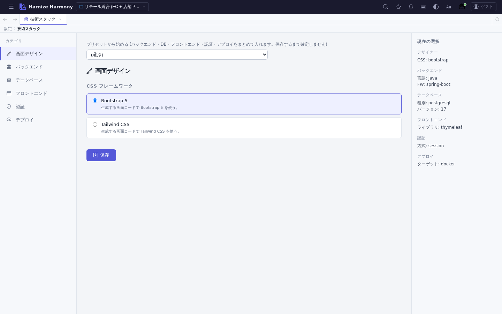

# 技術スタック選定

> **実画面で確認した日**: 2026-10-31 (E2E の実画面 `frontend/e2e/tech-stack-view.spec.ts` と、画面の見た目を目で確かめた) — **確認した範囲**: 「バックエンド」の言語・フレームワーク・ORM の選び方と、言語と組合せの制約・右の「現在の選択」・保存と読み直し・ORM の見た目 (ライト)。以前の記述の「各カテゴリの dropdown」「推奨組合せ」「Ctrl+S」「persistence / migration」「AI / 開発支援」は実画面に無く、誤りだったので削除した。**確認していない範囲**: ほかのカテゴリの細かい選び方・ダークテーマの見た目・プリセットの全 7 件の中身

> **対象画面**: `TechStackView` (`frontend/src/components/project/TechStackView.tsx`)
> **ルート**: `/w/:wsId/project/tech-stack`
> **種別**: シングルトンタブ

## 概要

プロジェクトが生成するコードの **技術スタック** を選ぶ画面。選んだ内容は `harmony.json` の `techStack` に保存され、`/generate-code` などで AI がコードを作るときの指針になる。

## 到達経路

- HeaderMenu → 「プロジェクト」 → 「技術スタック」
- 直接 URL: `/w/<wsId>/project/tech-stack`

## 画面構成

1. **左 (カテゴリ)** — 画面デザイン / バックエンド / データベース / フロントエンド / 認証 / デプロイ。押すと、中央の選択肢が切り替わる
2. **中央上 (プリセット)** — 「プリセットから始める」の選択欄。選ぶと、バックエンド・DB・フロントエンド・認証・デプロイをまとめて入れる (画面デザインは変えない。保存するまで確定しない)
3. **中央 (選択肢)** — 選択中のカテゴリの、ラジオボタンの群
4. **右 (現在の選択)** — 選んだ内容の一覧と、組合せの制約違反

## バックエンドの選び方

| 欄 | 選択肢 | 備考 |
|---|---|---|
| 言語 | Java / Kotlin / TypeScript / Python / Go | 未設定の表示は Java |
| フレームワーク | Spring Boot / NestJS / Express / FastAPI / Gin | 言語との組合せに制約がある (例: Java に Gin は選べない → 右に「制約違反」が出て、保存できない) |
| ORM | **Prisma (推奨)** / TypeORM | **言語が TypeScript のときだけ選べる**。ほかの言語のあいだは選べず、「ORM は、言語が TypeScript のときだけ選べます。」と出る。未設定は Prisma として扱う。言語を TypeScript 以外に変えると、ORM の指定は自動で外れる。TypeScript のプリセット (TypeScript フルスタック / 軽量) は ORM が Prisma |

右の「現在の選択」には `ORM: typeorm` のように出る。TypeScript で ORM が未設定のときは `ORM: prisma (既定)`。

## 主要操作

| 操作 | 手段 | 結果 |
|---|---|---|
| 選ぶ | ラジオボタン | 右の「現在の選択」に反映。保存するまで原本は変わらない |
| プリセットから始める | 中央上の選択欄 | まとめて入る。保存するまで確定しない |
| 組合せの違反 | 自動 | 右に「制約違反」と直し方が出て、「保存」が押せなくなる |
| 保存 | 「保存」ボタン | `harmony.json` の `techStack` を更新。「保存しました」が出る |

## データ前提

- **新規 project**: 何も選ばれていない (表示上の既定は Java / Spring Boot など)。プリセットから始めると速い

## 関連仕様書

- `harmony.json` schema の `techStack` — [`docs/spec/sample-project-structure.md`](../../spec/sample-project-structure.md)
- [`docs/spec/integration-ops.md`](../../spec/integration-ops.md) §13 — プリセットと組合せの制約
- [`docs/spec/code-generation.md`](../../spec/code-generation.md) — techStack の使われ方
- [`docs/user-guide/generate-code-workflow.md`](../generate-code-workflow.md) — 生成ワークフロー

## 関連 skill

- `/generate-code <flowId|screenId>` — techStack に基づき backend / frontend code を生成
- `/generate-tests <flowId|screenId>` — techStack に基づき test code を生成

## 既知の制約・注意

- techStack は **後から変更可**だが、既に生成済 code との整合を取るには `/generate-code` を再実行する必要
- 選択肢そのもの (言語・ORM の種類など) を増やすには、schema の変更 (設計者の判断) が要る
